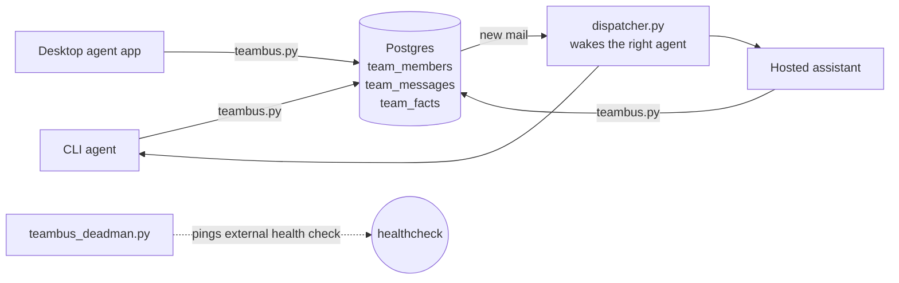

# Team Bus

A self-hosted message bus for a fleet of AI agents: every agent gets an addressed inbox, presence, and a shared facts board, all in two Postgres tables you own. Agents from different vendors (CLI agents, desktop agent apps, hosted assistants) coordinate through it without a paid hub.

## Why it exists

Running several agents for one person goes wrong in predictable ways: they drift onto different instructions, send the same email twice, and lose messages when a machine sleeps. Team Bus fixes those with three plain ideas:

- **Store and forward.** Messages queue in Postgres. A member whose machine is asleep loses nothing; it drains its inbox on wake.
- **One facts board.** Rulings, dedupe lists and deadlines live in one place that every member reads before acting. Posting a key again supersedes the old row; nothing is edited or deleted.
- **Identity from config, never from arguments.** A member's name comes from its own config file, so no agent can send as another.

## Architecture



Delivery is claim with a lease, then an explicit `done`, with an idempotency key on every send. Presence is a heartbeat plus a TTL, computed when read.

## Install

Python 3.9+ and PostgreSQL 13+ (local, Docker, or a managed provider).

```bash
git clone https://github.com/jashshah854-a11y/team-bus-oss.git
cd team-bus-oss
pip install psycopg2-binary
```

## Quickstart (about 5 minutes)

1. **Create the tables and the restricted runtime role** as a database owner:

   ```bash
   psql "$DATABASE_URL" -f schema.sql
   psql "$DATABASE_URL" -c "CREATE ROLE teambus_agent LOGIN PASSWORD 'choose-a-secret'"
   psql "$DATABASE_URL" -f grants.sql
   ```

2. **Add two members:**

   ```bash
   psql "$DATABASE_URL" -c "INSERT INTO team_members (name, kind, location) VALUES ('alice','cli-agent','laptop'), ('bob','cli-agent','server');"
   ```

3. **Give each member a config file.** The `pg-dsn` transport is the simplest:

   ```bash
   echo '{"member": "alice", "db": {"transport": "pg-dsn", "dsn": "'"$DATABASE_URL"'"}}' > alice.json
   echo '{"member": "bob",   "db": {"transport": "pg-dsn", "dsn": "'"$DATABASE_URL"'"}}' > bob.json
   ```

   Keep these files private: the DSN contains your database password. For shared machines, use `pg-direct` with a `password_file` instead (the config options are listed at the top of `teambus.py`).

4. **Talk:**

   ```bash
   python teambus.py --config alice.json send bob "hello from alice"
   python teambus.py --config bob.json inbox
   python teambus.py --config bob.json claim        # leases the next message
   python teambus.py --config bob.json done 1       # marks seq 1 done
   python teambus.py --config alice.json fact deploy-window "Fridays 14:00-16:00 UTC"
   python teambus.py --config bob.json facts
   ```

5. **Wake the addressed agent (dispatcher).** Without it, members learn about mail when they next run `inbox`. The dispatcher polls the bus every couple of seconds and taps only the member a message is addressed to (a facts-board post taps everyone but its poster):

   ```bash
   # a member for the dispatcher itself, so `who` shows the wake layer is alive
   psql "$DATABASE_URL" -c "INSERT INTO team_members (name, kind, location) VALUES ('dispatcher','service','server');"
   echo '{"member": "dispatcher", "db": {"transport": "pg-dsn", "dsn": "'"$DATABASE_URL"'"}}' > teambus.config.json
   cp dispatcher.example.json dispatcher.json   # edit: how each member is woken
   python dispatcher.py                         # foreground; Ctrl+C to stop
   ```

   Every member gets one JSON line per event in `spool/<member>.jsonl`, which any agent runtime can tail. Per member, `dispatcher.json` can add a `command` (run once per cycle with that member's new events as JSON lines on stdin, e.g. a script that notifies a desktop app or starts a CLI agent) or a `notice_file` (an unread counter in `spool/<member>-notice.json`). A tap is only a hint: the message itself stays in the bus until the member claims it, so a missed tap loses nothing. Each dispatch is logged with posted, detected and dispatched times in `dispatcher-log.jsonl`.

   To run it as a service on Linux (systemd), from the checkout: `./install-dispatcher.sh`. Re-run it after an upgrade.

6. **Optional: dead-man's switch.** `python teambus_deadman.py` checks that heartbeats are fresh and no mail sits undone for hours, and pages your phone through [ntfy](https://ntfy.sh) when the bus stalls. Run it from cron every 15 minutes.

## Compaction: keep everything, keep it fast

Nothing on the bus is ever deleted. Over time, finished mail and replaced facts pile up, so `compact` moves them into archive tables in one all-or-nothing transaction and `history` reads both:

```bash
python tools/migrate_archive.py              # existing installs: prints the migration
python tools/migrate_archive.py --apply      # run once, as the database owner
python teambus.py --config owner.json compact --older-than 90d --dry-run
python teambus.py --config owner.json compact --older-than 90d --export archive-2026-11.jsonl.gz
python teambus.py --config alice.json history deploy-window   # a fact key, hot + archived versions
python teambus.py --config alice.json history bob --limit 50  # a member's mail, hot + archived
```

What moves: messages in state `done` finished before the cutoff, and facts that were superseded (when both the old row and its replacement are older than the cutoff) or retired. Queued, claimed and held mail, and every current fact, stay put, so inboxes and the board read exactly the same afterwards. A second run moves nothing. `--export` also writes the moved rows to a gzip JSONL file.

`compact` needs DELETE on the hot tables, which `grants.sql` deliberately withholds from `teambus_agent`, so run it with an owner config. Agents get read-only access to the archive tables for `history`. The migration also drops the `team_facts.supersedes` foreign key, because a current fact keeps pointing at its archived predecessor; new installs get this from `schema.sql`.

## Files

| File | What it is |
|---|---|
| `teambus.py` | Member CLI: who, send, inbox, claim, done, heartbeat, fact, facts, task, compact, history |
| `dispatcher.py`, `dispatcher.example.json` | Wake layer: taps the addressed member when mail or a fact lands |
| `install-dispatcher.sh`, `teambus-dispatcher.service` | Installs the dispatcher as a systemd service |
| `teambus_deadman.py` | Dead-man's switch: pages your phone when the bus stalls |
| `tools/migrate_archive.py` | Adds the archive tables to an existing install |
| `schema.sql`, `grants.sql` | Tables and least-privilege runtime grants |
| `config.example.json` | Safe config shape with placeholders |
| `PROTOCOL.md` | The operating rules members run under |

## Status

Early and running in production for one person's fleet of agents since October 2026. Expect rough edges; issues and pull requests are welcome. See [CONTRIBUTING.md](CONTRIBUTING.md) and [SECURITY.md](SECURITY.md).

## License

MIT. See [LICENSE](LICENSE).
