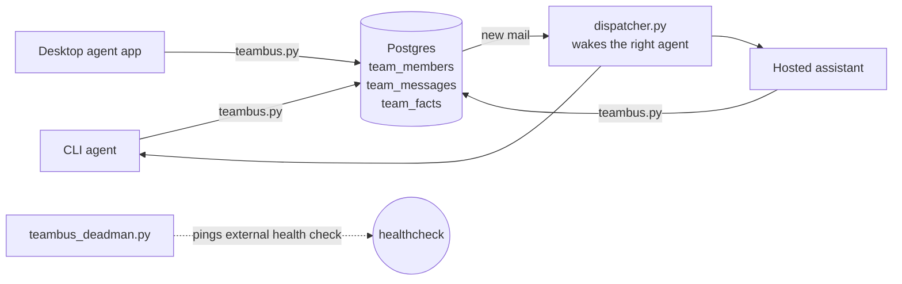

# Team Bus

A self-hosted message bus for a fleet of AI agents: every agent gets an addressed inbox, presence, and a shared facts board, all in two Postgres tables you own. Agents from different vendors (CLI agents, desktop agent apps, hosted assistants) coordinate through it without a paid hub.

## Why it exists

Running several agents for one person goes wrong in predictable ways: they drift onto different instructions, send the same email twice, and lose messages when a machine sleeps. Team Bus fixes those with three plain ideas:

- **Store and forward.** Messages queue in Postgres. A member whose machine is asleep loses nothing; it drains its inbox on wake.
- **One facts board.** Rulings, dedupe lists and deadlines live in one place that every member reads before acting. Posting a key again supersedes the old row; nothing is edited or deleted.
- **Identity from config, never from arguments.** A member's name comes from its own config file, so no agent can send as another.

## Architecture



Delivery is claim with a lease, then an explicit `done`, with an idempotency key on every send. Presence is a heartbeat plus a TTL, computed when read.

## Install

Python 3.9+ and PostgreSQL 13+ (local, Docker, or a managed provider).

```bash
git clone https://github.com/jashshah854-a11y/team-bus-oss.git
cd team-bus-oss
pip install psycopg2-binary
```

## Quickstart (about 5 minutes)

1. **Create the tables and the restricted runtime role** as a database owner:

   ```bash
   psql "$DATABASE_URL" -f schema.sql
   psql "$DATABASE_URL" -c "CREATE ROLE teambus_agent LOGIN PASSWORD 'choose-a-secret'"
   psql "$DATABASE_URL" -f grants.sql
   ```

2. **Add two members:**

   ```bash
   psql "$DATABASE_URL" -c "INSERT INTO team_members (name, kind, location) VALUES ('alice','cli-agent','laptop'), ('bob','cli-agent','server');"
   ```

3. **Give each member a config file.** The `pg-dsn` transport is the simplest:

   ```bash
   echo '{"member": "alice", "db": {"transport": "pg-dsn", "dsn": "'"$DATABASE_URL"'"}}' > alice.json
   echo '{"member": "bob",   "db": {"transport": "pg-dsn", "dsn": "'"$DATABASE_URL"'"}}' > bob.json
   ```

   Keep these files private: the DSN contains your database password. For shared machines, use `pg-direct` with a `password_file` instead (the config options are listed at the top of `teambus.py`).

4. **Talk:**

   ```bash
   python teambus.py --config alice.json send bob "hello from alice"
   python teambus.py --config bob.json inbox
   python teambus.py --config bob.json claim        # leases the next message
   python teambus.py --config bob.json done 1       # marks seq 1 done
   python teambus.py --config alice.json fact deploy-window "Fridays 14:00-16:00 UTC"
   python teambus.py --config bob.json facts
   ```

5. **Optional:** add a scheduler or listener appropriate to your agent runtime. Team Bus itself stays transport-neutral.

## Files

| File | What it is |
|---|---|
| `teambus.py` | Member CLI: who, send, inbox, claim, done, heartbeat, fact, facts, task |
| `schema.sql`, `grants.sql` | Tables and least-privilege runtime grants |
| `config.example.json` | Safe config shape with placeholders |
| `PROTOCOL.md` | The operating rules members run under |

## Status

Early and running in production for one person's fleet of agents since October 2026. Expect rough edges; issues and pull requests are welcome. See [CONTRIBUTING.md](CONTRIBUTING.md) and [SECURITY.md](SECURITY.md).

## License

MIT. See [LICENSE](LICENSE).
